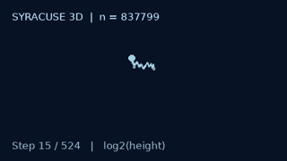

# Syracuse — Collatz Research Engine

**High-performance Rust engine · SQLite checkpoints · Python scientific visualizations**

**Developer:** Hamdy Abou El Anein · **Contact:** info@daylightlinux.ch · **License:** GPL-3.0-only

Syracuse is an open-source research toolkit for investigating the **Collatz conjecture** (the **3n + 1 problem**). **Rust is the recommended engine for computation**: it performs parallel scans, supports arbitrarily large individual starting values, displays progress and writes resumable SQLite checkpoints. Python remains available for random sampling, CSV export and visualizations.

For any positive integer `n`: if `n` is even, divide by 2; otherwise compute `3n + 1`. The conjecture states that repeated application eventually reaches 1. **It remains unproved.** Finite computational experiments are not mathematical proofs.

## Animated 3D trajectory

[](docs/gallery/syracuse-3d.html)

*The 524-step trajectory of 837799, displayed as a rotating logarithmic 3D embedding (not a physical orbit).*

**[Interactive 3D explorer](docs/gallery/syracuse-3d.html)** · **[964-step record in 3D](docs/gallery/syracuse-3d-record.html)** · **[Interactive inverse tree](docs/gallery/inverse-tree-interactive.html)** · **[Visualization gallery](docs/gallery/)**

## Why Rust?

- **Fast native computation:** optimized `u128` arithmetic with exact `BigUint` fallback on overflow
- **Multicore range scans:** Rayon parallel execution with configurable `--workers`
- **Exact results:** standard Collatz step counts, including compressed runs of even steps
- **Resumable SQLite:** compatible with the Python `results` table; existing completed entries are skipped
- **Progress display:** percentage, throughput and estimated time remaining; updates throttled to approximately once per second
- **Large single values:** arbitrary-precision starting integers, beyond 128 bits
- **Verification:** Rust unit tests compare the optimized implementation against an exact reference

Rust range scans report `reached_1` and `limit`; the Python analyzer also supports explicit cycle detection. A step limit is **not** a counterexample.

## Quick start — Rust (recommended)

Install a recent stable Rust toolchain and build the release binary:

```bash
git clone https://github.com/hamdyaea/Syracuse.git
cd Syracuse/rust
cargo build --release
cargo test
```

**Manjaro note:** if your default Rust toolchain is older, use the installed 1.88 toolchain instead:

```bash
cargo +1.88.0 build --release
cargo +1.88.0 test
```

### Analyze one starting number

```bash
./target/release/syracuse-rs 27
./target/release/syracuse-rs 837799 --max-steps 100000
```

### Analyze a very large integer (arbitrary precision)

```bash
./target/release/syracuse-rs \
  115792089237316195423570985008687907853269984665640564039457584007913129639935 \
  --max-steps 1000000
```

### Scan one million integers with four threads

```bash
./target/release/syracuse-rs \
  --start 1 --end 1000000 --workers 4 \
  --database ../syracuse.sqlite3
```

### Continue beyond the first 100 million

If your existing database already covers 1–100,000,000, continue with:

```bash
./target/release/syracuse-rs \
  --start 100000001 --end 200000000 \
  --workers 4 --max-steps 100000 \
  --database ../syracuse.sqlite3 --batch-size 16384
```

To scan through **one billion**, change `--end 200000000` to `--end 1000000000`. Choose a range appropriate for available CPU, storage and time.

**Resume after interruption:** run the same command again. Rust skips stored completed rows and recomputes previously step-limited rows only when `--max-steps` is increased. SQLite commits each batch transactionally. The progress counter measures the requested range **visited**, including skipped entries; the final `newly_computed` value counts new computations.

**Database selection:** `../syracuse.sqlite3` shares the existing Python-compatible dataset. Use `../syracuse-rust.sqlite3` for an independent experiment. The schema is `results(start, steps, peak, status, max_steps)`; peaks are decimal text to preserve precision. The SQLite range key is a signed 64-bit integer (maximum `9,223,372,036,854,775,807`). Single-value Rust analysis supports larger numbers but does not save them to that table.

**Without `--database`**, the range scan runs without SQLite writes; results are summarized but **cannot be resumed**. The display uses a single updating line in interactive terminals and newline-delimited progress messages when redirected. For details, see the [Rust engine documentation](rust/README.md).

## Research visualizations (Python)

The compute engine is Rust-first; the current plotting and interactive HTML generators remain Python-based.

From the repository root:

```bash
python3 visualize3d.py 837799 --output syracuse-3d.html
python3 inverse_explorer.py --depth 20 --max-nodes 600 --output inverse-tree-interactive.html
python3 inverse_tree.py --depth 12 --output inverse-tree.svg
```

Open the HTML files in a browser to explore the trajectory or finite inverse tree offline. The inverse tree is a bounded visualization rooted at 1, **not** evidence of universal convergence.

For an optional PNG trajectory plot (requires Matplotlib):

```bash
python3 syracuse.py 837799 --plot collatz-837799.png
```

### Random sampling of 128-bit integers

The seeded, persistent random explorer is still implemented in Python:

```bash
python3 explore.py --count 10000 --bits 128 --seed 2027 \
  --workers 4 --database explore-128.sqlite3
python3 explore.py --records-only --database explore-128.sqlite3
```

For CSV export of the contiguous SQLite results:

```bash
python3 syracuse.py --database syracuse.sqlite3 --export-csv results.csv
```

Do not upload research databases to GitHub; keep backups before large experiments.

## Speed and SQLite tuning (November 2026)

The default SQLite batch size is now **16,384 rows** (previously 4,096), reducing the number of transactions. Connection-local cache and in-memory temporary storage are enabled without changing SQLite's synchronous or journal durability policy. Existing databases are not migrated or deleted.

On a **fresh temporary SQLite database**, four-worker scans of 2,000,000 integers (310,000,001–312,000,000) took **5.578 s** with 4,096-row batches and **4.803 s** with 16,384-row batches in an initial test (about 14% less elapsed time). In a later test with the updated connection tuning, timings were **6.610 s** and **5.718 s** respectively. These are single-run observations and are **not** a prediction for a 100-million-row run. Always benchmark using a fresh test database and identical range.

**Disk-space caution:** large SQLite scans grow the database substantially. Check free space with `df -h .` and back up your database before major runs. For your next scan, consider:

```bash
cd rust
./target/release/syracuse-rs --start 300000001 --end 400000000 \
  --workers 4 --max-steps 100000 --database ../syracuse.sqlite3 \
  --batch-size 16384
```

The 3D HTML explorers now provide a **trajectory-position slider** and a **rotation toggle**, in addition to drag, zoom, playback speed and pause.

## Recorded experiments (November 2026)

These are **local experimental observations**, not universal proofs or world records.

| Experiment | Recorded result |
|---|---|
| Contiguous scan | 300,000,000 starting integers evaluated across successive ranges (based on reported runs) |
| Additional work in the previous Python run | 90,000,000 new integers in 843.79 seconds |
| Rust scan 100,000,001–200,000,000 | 98,488,576 newly computed; 422.798 seconds; longest 953 steps at 169,941,673 |
| Rust scan 200,000,001–300,000,000 | 100,000,000 newly computed; 406.687 seconds; longest 964 steps at 268,549,803 |
| Highest peak in latter Rust scan | 6,404,797,161,121,264 at 210,964,383 |
| Unresolved in that scan | 0 |
| Longest trajectory among those 90 million | 949 steps, starting at 63,728,127 |
| Largest peak among those 90 million | 2,185,143,829,170,100, starting at 80,049,391 |
| Random 80-bit sample | 10,000 starting integers; all reached 1 |
| Longest trajectory in 80-bit sample | 1,096 steps, starting at 1104823904239754287061021 |
| Largest peak in 80-bit sample | 40,629,227,929,758,396,698,586,962,452 |

The initial 100-million range was confirmed in SQLite; later range measurements are user-provided Rust output. The 90-million timing refers to the **previous Python implementation**. Record values above are scoped to their respective experiments, not necessarily global database records.


## Tests and project layout

```bash
cd rust && cargo test && cd ..
python3 -m unittest discover -s tests -v
```

| Path | Purpose |
|---|---|
| `rust/` | Native parallel Collatz engine and SQLite persistence |
| `syracuse.py` | Python reference CLI, plotting, CSV export and SQLite |
| `explore.py` | Seeded arbitrary-bit random sampling and local records |
| `visualize3d.py` | Self-contained animated 3D HTML visualization |
| `inverse_explorer.py` | Interactive finite inverse-tree HTML |
| `inverse_tree.py` | Finite inverse-tree SVG/JSON generation |
| `docs/gallery/` | Published GIF, HTML and SVG examples |
| `tests/` | Python correctness tests |

## Scientific limitations and next steps

A completed trajectory demonstrates convergence **only for that tested starting integer**. A `limit` status means the step budget was exhausted, not that a counterexample exists. The next engineering goals include larger-scale SQLite benchmarks, Rust-native seeded random sampling, more efficient caching and a unified visualization dashboard.

## License and history

**GPL-3.0-only.** The original implementation is preserved in the [old branch](https://github.com/hamdyaea/Syracuse/tree/old).

Further reading: [Collatz conjecture (English)](https://en.wikipedia.org/wiki/Collatz_conjecture) · [Conjecture de Syracuse (français)](https://fr.wikipedia.org/wiki/Conjecture_de_Syracuse).