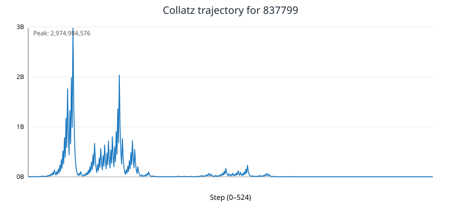
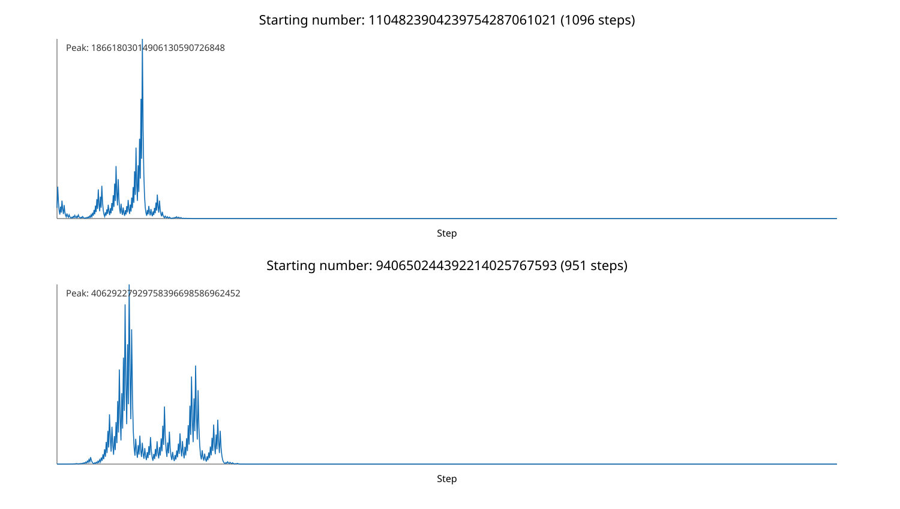

# Syracuse / Collatz Research Engine

**Developer:** Hamdy Abou El Anein  
**Contact:** info@daylightlinux.ch  
**License:** GPL-3.0-only

A Python 3 research CLI for exploring the **Collatz conjecture**, also known as the **Syracuse conjecture** or **3n + 1 problem**.

**Learn about the conjecture:** [Wikipedia (French): Conjecture de Syracuse](https://fr.wikipedia.org/wiki/Conjecture_de_Syracuse) · [Wikipedia (English): Collatz conjecture](https://en.wikipedia.org/wiki/Collatz_conjecture)

The conjecture states that every positive integer eventually reaches 1 when even numbers are divided by 2 and odd numbers are replaced with `3n + 1`. This has **not been proven** for all positive integers. Computational checks do not constitute a mathematical proof.

## Features

- Exact integer arithmetic; original, uncompressed Collatz step counts
- Single-number sequences and optional PNG trajectory plots
- Parallel range scanning using multiple CPU processes
- Per-batch memoization of completed trajectories (stopping time and maximum)
- Indexed, batched SQLite lookups instead of one query per starting integer
- SQLite checkpoints and automatic resume of completed calculations
- Distinguishes `reached_1`, `limit`, and `cycle`
- CSV export and automated tests

## Requirements

- Python 3.10+ (standard library for scanning, saving and exporting)
- Optional: Matplotlib for plotting: `python3 -m pip install matplotlib`

## Installation

```bash
git clone https://github.com/hamdyaea/Syracuse.git
cd Syracuse
python3 -m unittest discover -s tests -v
```

## Usage examples

### Display a sequence

```bash
python3 syracuse.py 27
python3 syracuse.py 27 --max-steps 1000
```

### Create a trajectory graph (PNG)

```bash
python3 -m pip install matplotlib
python3 syracuse.py 27 --plot collatz-27.png
python3 syracuse.py 837799 --plot collatz-837799.png
```

The generated image shows the starting value's trajectory, step by step, until 1. Plotting is optional; no graphical desktop is required because Matplotlib uses the noninteractive Agg backend.

### Scan 1 million integers on 4 CPU processes

```bash
python3 syracuse.py --start 1 --end 1000000 --workers 4
```

### Extend the scan to 10 million, resuming existing results

```bash
python3 syracuse.py --start 1 --end 10000000 --workers 4 \
  --database syracuse.sqlite3 --batch-size 5000
```

Existing completed rows in the database are skipped. Increasing `--max-steps` retries rows previously marked `limit`. Batch size controls SQLite lookup/write granularity and the amount of work reprocessed after interruption. Try `1000` (default) or `5000` and benchmark on your own hardware.

### Export stored results to CSV

```bash
python3 syracuse.py --database syracuse.sqlite3 --export-csv results.csv
```

CSV columns: `start,steps,peak,status,max_steps`. Peak values are stored as text to preserve large integer precision.

### Test a smaller limit

```bash
python3 syracuse.py --start 1 --end 10000 --workers 2 \
  --max-steps 100 --database limited.sqlite3
```

A `limit` result means the configured step budget was exhausted, **not** that a counterexample has been discovered. A `cycle` result indicates a repeated value before reaching 1.

## Example results

A sample run on positive integers from 1 through 1,000,000 reported:

| Metric | Result |
|---|---:|
| Starting integers checked | 1,000,000 |
| Unresolved | 0 |
| Longest stopping time | 524 steps (837799) |
| Highest peak | 56,991,483,520 (704511) |
| Runtime before the batching optimization | 49.68 seconds with 4 workers |

These are example results from a user run, **not** a performance guarantee or a benchmark of the optimized implementation.

### Verified scan through 10 million (previous engine)

The following values were reported from a local scan with four workers. The database already contained the first 1,000,000 values; the reported runtime covers only the **9,000,000 newly processed** starting integers.

| Metric | Result |
|---|---:|
| Range in database | 1–10,000,000 |
| Newly processed | 9,000,000 |
| Unresolved trajectories | 0 |
| Elapsed time for new work | 364.30 seconds |
| Longest newly completed trajectory | 685 steps, start 8,400,511 |
| Highest newly completed peak | 60,342,610,919,632, start 6,631,675 |

These are user-provided run results from the **pre-optimization engine**, not a benchmark of the current optimized engine. For comparison, a separate clean database should be used.

### Example trajectory graph



The SVG above is generated from the exact Collatz sequence of 837799 (524 steps, peak 2,974,984,576). To generate a Matplotlib PNG yourself:

```bash
python3 syracuse.py 837799 --plot collatz-837799.png
```

## Explore large random integers and local records

Use `explore.py` to explore **large random starting values**, rather than attempting to surpass exhaustive global verification records. The results are **records within your own sample**, not mathematical world records or counterexamples.

```bash
# 10,000 reproducible random 80-bit starting values with 4 processes
python3 explore.py --count 10000 --bits 80 --seed 2026 --workers 4

# Explore 1,000 random 128-bit integers, with a separate database
python3 explore.py --count 1000 --bits 128 --seed 2027 --workers 4 \
  --database explore-128.sqlite3

# Read the highest peak and longest completed stopping time in saved samples
python3 explore.py --records-only --database explore-128.sqlite3

# Export record summary as CSV
python3 explore.py --records-only --database explore-128.sqlite3 \
  --export-records records.csv

# Create a PNG showing the most interesting completed trajectories
python3 explore.py --records-only --database explore-128.sqlite3 \
  --plot-records records.png
```

`--seed` makes samples reproducible; `--bits` sets the exact bit length of starting numbers. SQLite stores these arbitrary-size integers as text. Completed samples are skipped on rerun with the same seed and database. Samples that reached the step limit are retried when `--max-steps` is increased. Changing the seed or bit length explores additional numbers in the same database.

For plotting, install optional Matplotlib. The `--plot-records` option draws the longest completed trajectory and the highest completed peak from the database; these may be the same starting number. If a sample reaches the configured step limit, it is **unresolved**, not a counterexample.

## Experimental results: 100 million and 80-bit sampling (November 2026)

The following measurements were supplied from actual local runs. They are **not world records** and do not prove the conjecture. The two workloads are different and their runtimes must not be compared as equivalent benchmarks.

### Exhaustive scan: 1 to 100,000,000

The existing SQLite database already contained 10 million completed rows. The following run added **90 million** new values, reaching a total of **100 million**:

| Metric | Recorded result |
|---|---:|
| Stored starting integers | 100,000,000 |
| Newly evaluated in this run | 90,000,000 |
| Unresolved | 0 |
| Elapsed time for new work | 843.79 seconds |
| Longest trajectory among newly evaluated | 949 steps, start 63,728,127 |
| Largest peak among newly evaluated | 2,185,143,829,170,100, start 80,049,391 |

These records are explicitly scoped to the **newly evaluated 90 million**; they are not automatically global database records.

### Random exploration: 10,000 reproducible 80-bit numbers

```bash
python3 explore.py --count 10000 --bits 80 --seed 2026 --workers 4
python3 explore.py --records-only --plot-records records.png
```

| Metric | Recorded result |
|---|---:|
| Sampled starting integers | 10,000 |
| Reached 1 | 10,000 |
| Step-limited | 0 |
| Cycles | 0 |
| Elapsed time | 0.74 seconds |
| Longest trajectory | 1,096 steps |
| Starting number for longest trajectory | 1104823904239754287061021 |
| Largest peak | 40,629,227,929,758,396,698,586,962,452 |
| Starting number for largest peak | 940650244392214025767593 |

The longest-trajectory starting number reaches a peak of 18,661,803,014,906,130,590,726,848. The largest-peak starting number reaches 1 in 951 steps.



The SVG is reconstructed directly from the two recorded starting numbers using the project's exact recurrence. To reproduce the corresponding Matplotlib PNG locally, run the `--plot-records` command above against the saved `syracuse-explore.sqlite3` database.

**Interpretation:** The sample contains interesting local records, but does not establish new mathematical results beyond the tested starting values. The elapsed times include process and persistence overhead and vary by hardware.

## Performance and correctness

The parallel engine sends batches of starting integers to worker processes, memoizes only tails already known to reach 1, and stores each batch transactionally. This reduces SQLite query overhead and repeated Collatz arithmetic. Actual speedups depend on CPU, database, batch size and the range being tested.

The program stores start values in SQLite's signed 64-bit INTEGER column; starting values must be at most `2**63 - 1`. Intermediate Collatz values use Python's arbitrary-precision integers.

Run the test suite after upgrades:

```bash
python3 -m unittest discover -s tests -v
```

## License and history

GPL-3.0-only. Original version preserved in the [old branch](https://github.com/hamdyaea/Syracuse/tree/old).
